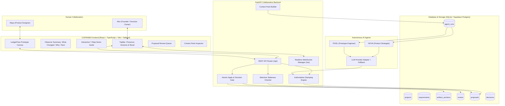
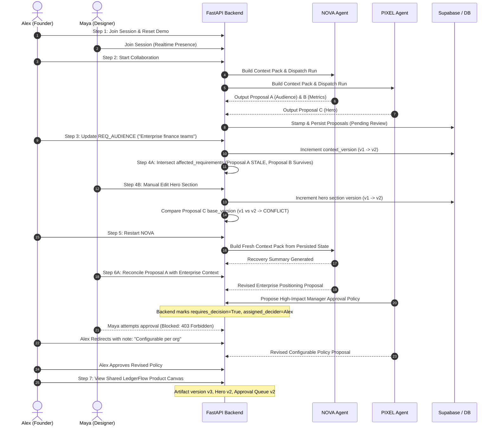

# COFRAME — System Architecture & Workflow Specification

## 1. Architectural Philosophy: The Calm Mission Control

COFRAME treats human-AI product creation not as an unstructured chat log, but as an **authoritative multiplayer workspace** governed by strict data contracts, selective dependency versioning, and ACID persistence.

---

## 2. Core Versioning Contracts

COFRAME maintains three independent, uncollapsed version counters:

1. `context_version`: Incremented whenever project requirements or decisions are updated by human collaborators.
2. `artifact_version`: Incremented whenever an approved proposal or manual edit modifies the overall Product Canvas.
3. `section_versions`: Discrete version integer per target section (`product_brief: vX`, `hero: vY`, `dashboard: vZ`, `approval_queue: vW`).

---

## 3. Seven-Step Demo Flow Sequence

