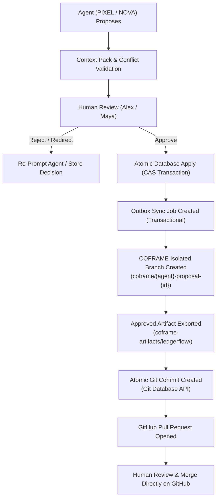

# COFRAME × GitHub Integration Guide

## 1. Overview & Vision

**COFRAME — Human + AI, One Shared Creation** bridges autonomous AI product collaboration into real-world software engineering workflows.

Rather than confining AI contributions to isolated chat sessions or volatile memory, COFRAME connects the four collaborators:
- **Humans:** Alex (Founder / Decision Owner) and Maya (Product Designer)
- **AI Agents:** NOVA (Product Strategist) and PIXEL (Prototype Engineer)

to external GitHub repositories. Approved artifact states are exported directly into dedicated, isolated Git branches with atomic commits and human-reviewable Pull Requests.



---

## 2. Critical Architectural Principles

1. **Human Governance First:** AI agents cannot push directly to default branches, nor can they merge pull requests automatically. Humans review diffs and execute merges on GitHub.
2. **Only Approved Work Ships:** Rejected, stale, conflicted, or unreviewed proposals are strictly blocked from GitHub publication.
3. **Outbox Pattern for Reliability:** When a proposal is approved in COFRAME, a local `GitHubSyncJobModel` record is committed in the same database transaction as the proposal approval. GitHub network or rate-limit failures cannot corrupt or roll back approved COFRAME artifact state.
4. **Backend Owns Credentials:** GitHub Personal Access Tokens are held securely on the backend in environment variables. Tokens are never exposed to the frontend, agents, or database logs.
5. **No Arbitrary Code Generation:** The current LedgerFlow prototype exports verified, structured JSON artifacts (`manifest.json`, `product_brief.json`, `hero.json`, `dashboard.json`, `approval_queue.json`, `proposals/{id}.json`, `CHANGELOG.md`) rendered by trusted React components.

---

## 3. Configuration & Environment Setup

Add the following variables to your `.env` file:

```env
# GitHub Integration Configuration
# Fine-grained PAT or classic token with contents:write and pull_requests:write
GITHUB_TOKEN=ghp_your_secure_personal_access_token_here
GITHUB_OWNER=Satvik-4web
GITHUB_REPO=ledgerflow-product
GITHUB_BASE_BRANCH=main
GITHUB_AUTO_CREATE_PR=true
GITHUB_WEBHOOK_SECRET=
```

### GitHub Token Permissions Required:
- **Repository Metadata:** Read
- **Repository Contents:** Read & Write
- **Pull Requests:** Read & Write

---

## 4. API Endpoints Reference

All endpoints are prefixed with `/api/github` and scoped to the active project (defaulting to `demo-ledgerflow`):

| Method | Endpoint | Description |
| :--- | :--- | :--- |
| `GET` | `/api/github/status` | Returns token configuration status and connection health. |
| `POST` | `/api/github/connect` | Connects a repository (`owner`, `repository_name`, `default_branch`). |
| `DELETE` | `/api/github/disconnect` | Disconnects the current repository. |
| `GET` | `/api/github/repository` | Returns repository metadata (stars, forks, default branch, URL). |
| `GET` | `/api/github/branches` | Lists branches, identifying COFRAME-created branches. |
| `GET` | `/api/github/commits` | Lists commit history with COFRAME proposal attribution. |
| `POST` | `/api/github/proposals/{id}/publish` | Publishes an approved proposal to GitHub. |
| `GET` | `/api/github/contributions` | Lists all published contributions and their PR states. |
| `GET` | `/api/github/contributions/{id}` | Gets single contribution details. |
| `POST` | `/api/github/contributions/{id}/retry` | Retries a failed publishing job. |
| `GET` | `/api/github/pull-requests` | Lists pull requests for the repository. |
| `POST` | `/api/github/pull-requests/{number}/refresh` | Refreshes PR state from GitHub API. |
| `POST` | `/api/github/webhooks` | Optional HMAC SHA-256 webhook handler. |

---

## 5. Artifact Export Structure

Published contributions populate the target repository with the following structure:

```
coframe-artifacts/
    ledgerflow/
        manifest.json           # Provenance metadata (project, proposal, agent, approver, versions)
        product_brief.json      # Approved product strategy & audience positioning
        hero.json               # Approved hero headline and supporting copy
        dashboard.json          # Approved financial metric cards and metrics
        approval_queue.json     # Approved manager review thresholds and policy rules
        proposals/
            {proposal_id}.json  # Immutable snapshot of the originating proposal
        CHANGELOG.md            # Human-readable version changelog
```

---

## 6. End-to-End Demo Workflow

To demonstrate the GitHub integration during a live evaluation:

1. Navigate to the **GitHub** tab in the COFRAME sidebar.
2. Verify repository status is **Connected** (`Satvik-4web/ledgerflow-product`).
3. Click on the **Overview**, **Branches**, and **Commits** tabs to view live repository data.
4. Switch to the **Proposals** tab and approve an eligible proposal (or view an approved one from Step 6).
5. Click **Publish to GitHub**.
6. The system executes the publishing workflow:
   - Creates branch `coframe/pixel-proposal-...`
   - Exports the artifact files
   - Creates an atomic commit
   - Opens Pull Request `#...`
7. Click **Open Pull Request** to inspect the real PR on GitHub with full COFRAME provenance.
8. Switch to the **Contribution Chain** tab in COFRAME to demonstrate end-to-end traceability from AI reasoning to Git commit.
